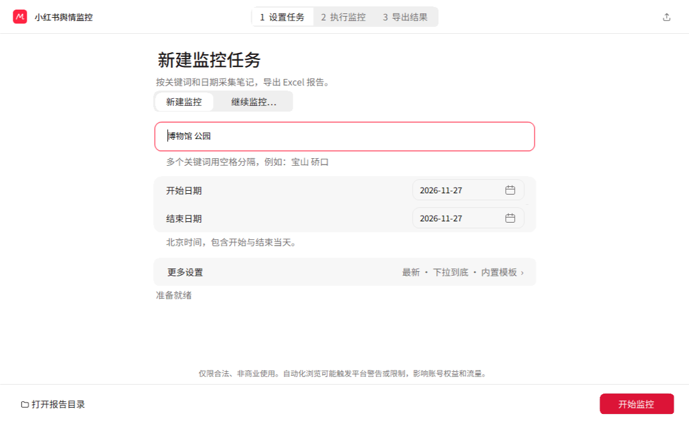

# 小红书舆情监控

简体中文 · [English](README.en.md)

## 使用范围与平台风险

**仅限合法、非商业使用。** 本项目公开源码，供个人学习、研究和测试等非商业用途。严禁用于违法活动或商业营利。使用前，请确认你有权访问及处理相关内容，并遵守适用法律和小红书的平台规则。

**自动化浏览可能触发账号安全措施。** 小红书可能将自动化浏览识别为异常行为，发出账号警告、要求验证或限制访问。根据平台提示，多次违规可能影响账号权益和流量。收到警告或遇到限制时，请停止任务并按平台指引处理。

提供 Windows、macOS、Linux 桌面版和鸿蒙电脑华为浏览器扩展预览版。按关键词和发布日期采集笔记，用 Markdown 模板导出 Excel。支持 OpenAI、Claude、Gemini、DeepSeek、Kimi、GLM 与 Qwen。

## 下载

| 系统 | 下载 | 发布说明 |
| --- | --- | --- |
| Windows | [Setup x64](https://github.com/slirens/xiaohongshu-monitor/releases/download/v1.1.2/xiaohongshu-monitor-v1.1.2-windows-x64-setup.exe) · [Setup x86](https://github.com/slirens/xiaohongshu-monitor/releases/download/v1.1.2/xiaohongshu-monitor-v1.1.2-windows-x86-setup.exe) | [v1.1.2](https://github.com/slirens/xiaohongshu-monitor/releases/tag/v1.1.2) |
| macOS | [DMG Apple Silicon](https://github.com/slirens/xiaohongshu-monitor/releases/download/v1.1.2/xiaohongshu-monitor-v1.1.2-macos-arm64.dmg) · [DMG Intel x64](https://github.com/slirens/xiaohongshu-monitor/releases/download/v1.1.2/xiaohongshu-monitor-v1.1.2-macos-x86_64.dmg) | [v1.1.2](https://github.com/slirens/xiaohongshu-monitor/releases/tag/v1.1.2) |
| Linux | [DEB x64](https://github.com/slirens/xiaohongshu-monitor/releases/download/v1.1.2/xiaohongshu-monitor-v1.1.2-linux-amd64.deb) | [v1.1.2](https://github.com/slirens/xiaohongshu-monitor/releases/tag/v1.1.2) |
| 鸿蒙电脑 | [华为浏览器扩展 ZIP（预览）](https://github.com/slirens/xiaohongshu-monitor/releases/download/v1.1.2/xiaohongshu-monitor-v1.1.2-harmonyos-browser.zip) | [v1.1.2](https://github.com/slirens/xiaohongshu-monitor/releases/tag/v1.1.2) |

Windows 版要求 Windows 10 或更新版本，支持 Microsoft Edge、Google Chrome 和 360 系列浏览器的 Chromium 极速模式。macOS 版要求 macOS 14 或更新版本，并使用 Safari。

Windows 安装程序未做 Authenticode 签名。macOS 应用使用临时签名，未经过 Apple 公证。首次打开时，系统可能提示安全确认。

## v1.1.2 更新 · What's new

- **继续监控读取提速**。Windows、macOS 和 Linux 优先从 Excel 直接读取续查数据，更快恢复关键词和日期。旧格式报告仍可导入。
- **恢复 Excel 文件名规则**。四个平台按「首个关键词_发起日期_关键词数_发起时间」命名，例如 `宝山_2026-11-24_2词_173050.xlsx`。时间采用任务发起时的北京时间，桌面版同秒重名时追加序号。

界面按系统显示语言选择简体中文或英文，华为浏览器扩展跟随浏览器语言。

[查看 v1.1.1 界面设计参考图](design/v2/reference/F1A-苹果基准-完整版.png)

## 内置舆情分析框架

[下载内置 Markdown 模板](https://github.com/slirens/xiaohongshu-monitor/releases/download/v1.1.2/analysis-template.md) · [查看模板源码](报告生成模板.md)

| 层级 | 内置分析框架 |
| --- | --- |
| 逐帖研判 | 结合标题和正文判断相关性、情绪与主题，写一句摘要。区分体验自述、观点和待核实信息。 |
| 总结 | 说明范围和样本量，归纳主要议题、风险和待核实事项。继续监控时，按执行日期保留新发现和互动变化。 |
| 总表及分表 | 总表按帖子去重；日期分表按发布日期拆分；多关键词可以分别查看。笔记明细包含原文地址及点赞、收藏、评论的上次值、本次值、增减和涨幅。 |

### 如何修改并导入

1. 下载模板并另存为一个 `.md` 文件。先修改「分析规则」和「总结」下的文字。例如新增「在总结中单列售后投诉，引用原文地址并注明处理进展」。只想调整分析重点时，保留下面的 JSON 即可。
2. 要改 AI 输出字段，编辑 `report-schema` 里的 `analysisFields` 和 `summarySections`。前者定义逐帖字段，后者定义总结栏目。常用修改是调整 `title` 和 `instruction`，并保留 `key`。逐帖字段支持 `text`、`boolean`、`enum`，枚举值在 `values` 中列出。
3. 要改 Excel 列布局，在 `sheets` 中调整相应 `columns` 的顺序。工作表类型为 `summary`、`overview`、`date`、`keyword`。例如把 `comments_delta` 和 `comments_rate` 移到 `title` 后面，可在标题旁显示评论增减和涨幅。新增逐帖字段时，将它的 `key` 加到相应工作表的 `columns` 中。
4. 以 UTF-8 保存 Markdown，保留 `report-schema` 代码块、`"version": 1` 和合法 JSON。在程序的「更多设置 → 报告生成模板」导入并选中它，填入所用 AI 服务的 API 密钥即可按模板分析。

互动变化由程序用实际采集值计算。互动明细使用 `likes`、`saves`、`comments` 保存本次值，分别加后缀 `_previous`、`_delta`、`_rate` 可引用上次值、增减和涨幅。关闭 AI 后仍可导出互动统计及模板布局。有「总结」「总表」「日期」三个标题的旧模板可继续使用默认布局。

桌面版将报告写入本机 `reports`。浏览器扩展直接下载 Excel 文件。

## 构建与运行

### Linux

在 Ubuntu 22.04 或 24.04 桌面版（x64）安装 Google Chrome 后，用软件安装器打开 DEB，或执行 `sudo apt install ./xiaohongshu-monitor-v1.1.2-linux-amd64.deb`。安装后从应用菜单打开「小红书舆情监控」，首次采集在程序打开的浏览器窗口完成登录。报告默认保存在 `~/.local/share/xiaohongshu-monitor/reports`。

如果系统里已安装版本号更高的旧版，APT 会提示确认降级。

从源码构建需要 amd64 Linux、`dpkg-deb` 和官方 Node.js 24 LTS（含 npm）。在仓库目录执行 `bash linux/build-deb.sh`。

### 鸿蒙电脑

解压扩展 ZIP，在华为浏览器的「管理扩展程序」加载含有 `manifest.json` 的文件夹。使用 HarmonyOS 6.0 或更新版本及华为浏览器 5.1.10.300 或更新版本。详细操作和源码构建命令见鸿蒙电脑扩展说明。 [安装与构建](harmonyos/README.md)

### macOS

打开对应芯片的 DMG，将应用拖入「应用程序」。在 Safari「设置 → 高级」显示网页开发者功能，然后在「开发 → 开发者设置」打开「允许来自 Apple 事件的 JavaScript」。在 macOS 的权限提示中允许应用控制 Safari。按应用提示在监控窗口完成登录。

从源码构建需要 macOS、Xcode Command Line Tools 和官方 Node.js 24 LTS（含 npm）。在仓库根目录执行 `bash macos/build.sh`，应用生成在 `macos-output`。报告生成在 `~/Library/Application Support/Xiaohongshu Monitor/reports`。

### Windows

64 位 Windows 下载 Setup x64，32 位 Windows 下载 Setup x86。运行安装程序，再从开始菜单打开「小红书舆情监控」。可通过 Windows「设置 → 应用」卸载。

从源码构建时，安装 Microsoft Edge 或 Google Chrome，准备对应架构的 Node.js（含 npm），然后在仓库目录执行以下命令。

- x64 使用 Node.js 24 LTS，执行 `pwsh -File .\build.ps1`。
- x86 使用 Node.js 22 LTS 的 32 位版本，执行 `pwsh -File .\build.ps1 -Architecture x86 -OutputDirectory .\dist\windows-x86 -Node "C:\tools\node-x86\node.exe"`。将示例中的 Node.js 路径换成实际路径。

首次运行在程序打开的浏览器窗口完成登录。多个关键词用空格分隔。需要 AI 分析时，在「更多设置」选择服务商并输入相应 API 密钥。开启 AI 分析会向所选平台发送笔记片段及报告总结所需的数据。

## 继续监控

选择「继续监控」后，程序默认带出最近生成的报告，也可以另选一份 Excel。报告中的全部搜索关键词会填回搜索框，可以增删和调整日期。程序按编辑后的列表搜索，复查这些关键词关联且仍可访问的旧帖，并把新发现和互动变化追加到新工作簿。移除的关键词仍保留在历史记录中。

总结页按执行日期保留每轮更新。总表和日期分表显示点赞、收藏、评论的上次值、本次值、增减数和涨幅。只有两次都成功读取的数值才参与比较；上次为零时保留增减数，涨幅留空。开启 AI 分析后，更新与互动变化一并纳入报告总结。

## 日期范围和划屏

选择「最新」和「下拉到底」时，发现一条发布日期早于开始日期的笔记后，程序完成当前屏的扫描并结束该关键词的划屏。开始日期当天仍纳入。开始日期超出「半年内」的覆盖范围时，这个组合使用网页发布时间的「不限」档位。

## 发布前检查

公开仓库只收录源码和示例模板。发布包单独构建，并附所分发依赖的许可证。

## 许可证

本项目采用 PolyForm Noncommercial License 1.0.0，见 [LICENSE](LICENSE)。
